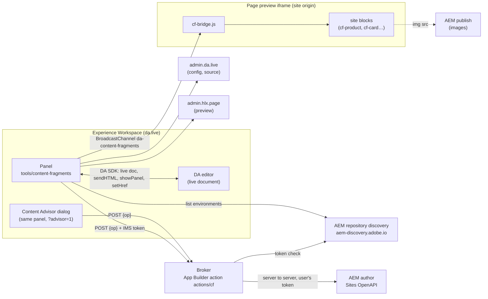
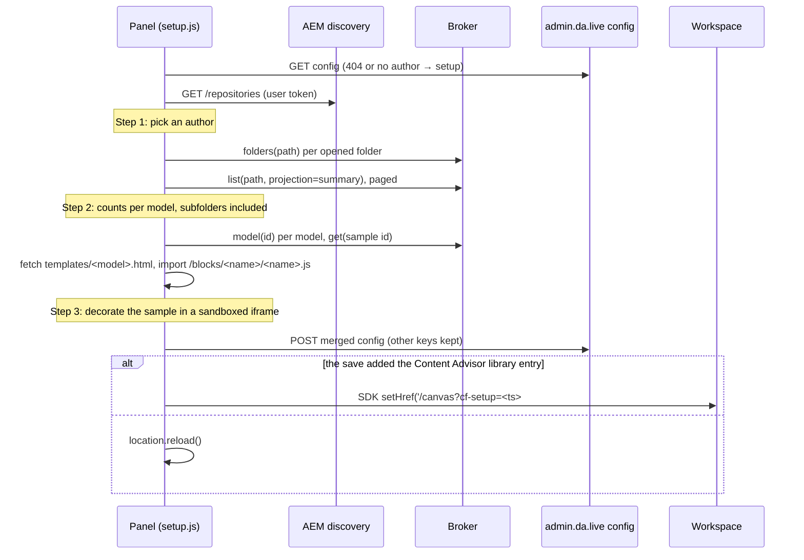
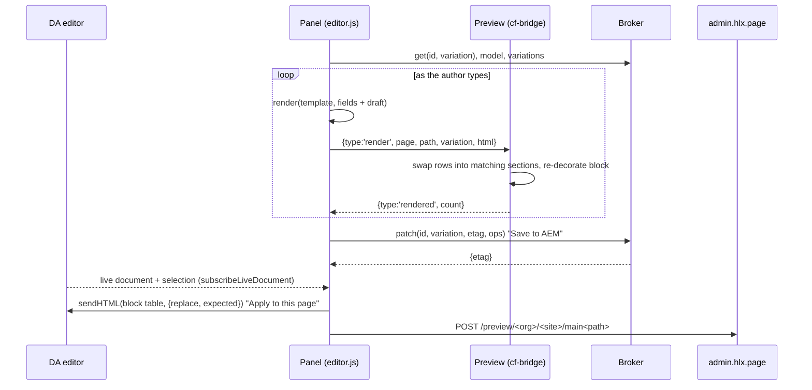
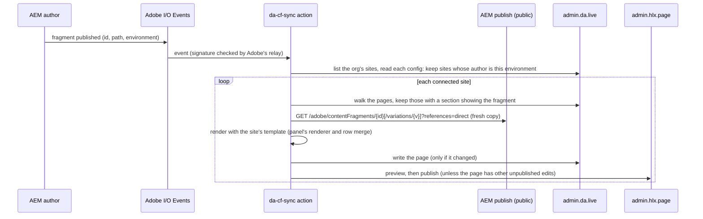

# Architecture

This is for developers who change the extension, run their own broker, or add it to a site.
How to use it is in [getting-started.md](getting-started.md). The config keys and the template
language are in the [README](../README.md).

## The parts



| Part | Where it runs | Code | Deployed by |
|---|---|---|---|
| Panel, setup wizard | DA library panel, in an iframe on the site's preview origin | `site/tools/content-fragments/` | Copied into each site repo; ships with the site's code |
| Content Advisor dialog | Workspace full-size dialog: the same panel with `?advisor=1` | `advisor.js` | Same as the panel |
| Renderer | Panel and setup (browser); scripts that build pages (Node) | `site/scripts/cf-render.js` | Copied into each site repo |
| Bridge | The page preview inside Workspace | `site/scripts/cf-bridge.js` | Copied into each site repo, loaded from `scripts.js` |
| Default block | The site | `site/blocks/cf-card/` | Copied into each site repo |
| Broker | Adobe I/O Runtime (App Builder web action) | `actions/cf/` | `npm run deploy`, once for all sites |

The panel, the renderer and the bridge are copied into each site, not loaded from a shared host,
for two reasons:
- Edge Delivery serves code without CORS headers, so a site cannot import modules from another
  site.
- The bridge talks to the panel over `BroadcastChannel`, which only connects documents of the
  same origin. So the panel must be served from the site's own preview origin.

## The broker

AEM author answers browser calls only from Adobe's own consoles. A panel on `da.live`,
`*.aem.page` or `*.preview.da.live` gets no CORS headers unless every AEM environment deploys
its own CORS policy through Cloud Manager. The broker removes that per-environment step: CORS is
configured once, on the action.

What it does, per request (`actions/cf/index.js`):

1. **Origin.** Answers CORS only for `da.live`, `<ref>--<site>--<org>.aem.page|live`,
   `<ref>--<site>--<org>.preview.da.live` and `localhost`. The `ALLOWED_ORIGINS` action input
   replaces this list.
2. **Token.** Requires `Authorization: Bearer <IMS token>`: the signed-in DA user's token,
   passed through from the DA SDK.
3. **Host check.** Calls AEM repository discovery with that token. The requested `author` must
   be one of the repositories the user can reach. The result is cached for 5 minutes per token
   hash, in warm containers only. No other host is ever called.
4. **Validation.** Every input is validated before any call (`actions/cf/lib.js`, `plan()`):
   - author host `author-pN-eN.adobeaemcloud.com`;
   - fragment ids as UUIDs;
   - `/content/dam` paths without `.` or `..` segments;
   - variation names, model ids and cursors.
5. **The AEM call**, server to server with the user's own token, so AEM permissions decide what
   they can read and change.
   - Writes need the strong ETag the client read (`If-Match`) and a fresh CSRF token.
   - Writes may only change `fields`, `title` or `description`: JSON Patch paths are checked.
6. **Reply.** Returns `{ data, etag }` or `{ error }`. AEM statuses are mapped to messages
   (409/412 → "changed in AEM since it was loaded").

The broker stores nothing and logs no tokens or request parameters.

### Operations

| `op` | Body | AEM request |
|---|---|---|
| `list` | `path, limit?, cursor?, projection?` | `GET /adobe/sites/cf/fragments?path=…` (recursive; `projection=summary` for scans) |
| `folders` | `path?, cursor?` | `GET /adobe/folders?path=…&limit=50` |
| `get` | `id, variation?` | `GET /adobe/sites/cf/fragments/{id}[/variations/{v}]?references=direct-hydrated` |
| `variations` | `id` | `GET …/fragments/{id}/variations` |
| `model` | `model` | `GET /adobe/sites/cf/models/{id}` |
| `metadata` | `id` | `GET …/fragments/{id}/metadata` |
| `patch` | `id, variation?, etag, ops` | `PATCH …/fragments/{id}[/variations/{v}]` |
| `patch-metadata` | `id, etag, ops` | `PATCH …/fragments/{id}/metadata` |

Every body also carries `author`.

### Who uses which broker

- **The default.** The panel uses `DEFAULT_BROKER` (`panel.js`), the AEM XSC stage action,
  unless the site's config sets `broker`. Any site that adds the extension uses that action by
  default.
- **Data.** The broker only passes the user's own token to the user's own AEM, so no data
  crosses organizations.
- **Operating cost.** Running the action and keeping it available is the AEM XSC team's job.
- **Your own broker.** Another organization (an engineering team, a partner, a customer) runs
  `npx github:AEMXSC/da-content-fragments backend --da-org <their DA org>` in its own App Builder
  project. That deploys its own broker and sync service; see
  [Run your own backend](../README.md#run-your-own-backend-any-adobe-organization). Sites then set
  `broker` under **More settings** in Setup.

## Flows

### Setup



- **Sample previews.** The site's block JS runs on a detached copy in the panel's document. The
  result is shown in an iframe with `sandbox="allow-same-origin"` and no scripts, with the
  site's `styles.css` and the block's CSS. The frame's `body` gets `class="appear"`, because EDS
  boilerplate CSS hides `body` until then.
- **Why setup reloads Workspace.** Workspace reads the library once, when it loads, and
  `showPanel` silently ignores ids it does not know. The Content Advisor entry Setup adds would
  stay unusable until a reload. The query parameter makes the browser load the page again,
  instead of only moving to a new address within it.

### Edit, save, apply



- **The preview swap is temporary.** It changes the preview only; reloading the preview shows
  the stored page again.
- **The bridge finds sections** by Section Metadata `Fragment` / `Variation`, or by a
  `content-fragment` block. It replaces the block's rows with the authored markup and runs the
  site's `decorateBlock` and `loadBlock`.
- **Apply goes through the editor.** It never writes to the stored source: a page open in DA is
  a live collaborative session, and the next editor save would overwrite that write.
- **Stale edits are refused.** `sendHTML` replaces only the selected block, guarded by
  `expected` (the document and selection the panel saw); if either changed, nothing is written.
  `findBlock` (`apply.js`) maps a reference to the block's ordinal among
  `div[data-block-index]`, which is how the editor counts `selection.blockIndex`.

### Content Advisor insert

`advisor.js` loads Adobe's asset selectors script
(`experience.adobe.com/…/assets-selectors.js`) and renders Content Advisor in content-fragments
mode, on the configured `advisor-folder`. On **Insert**:

- **Validation.** Each pick must have a `/content/dam` path, and each variation name is checked.
- **Rendering.** Each fragment is drawn with its model's template.
- **Insert.** `sectionInsert` sends `<hr>` + block table + section-metadata table + `<hr>` to the
  cursor with `sendHTML`.
- **Table shape.** The DA editor pads short rows to the widest row with empty cells. So a short
  row's last cell gets a `colspan` for the rest of the table (`blockTable`). Blocks should drop
  empty cells anyway: see [Writing templates](../README.md#writing-templates).

## The sync service

Publishing a fragment in AEM updates the Edge Delivery pages that show it, with nobody in DA.
An App Builder action, `da-cf-sync/fragment-published` (`actions/sync/`), runs on AEM's
`aem.sites.contentFragment.published` event:



- **No AEM credential.** The fragment is read from AEM publish, which serves it to anyone.
  Asset ids in the delivery JSON become `/content/dam` paths (`references=direct`), long text is
  unwrapped from `{ value, mimeType }`: the result is the data the panel gets from author, so the
  page comes out exactly as the panel renders it.
- **Fresh content.** AEM publish's CDN can still hold the copy from before the publish that sent
  the event. A response whose `Last-Modified` is older than the event is fetched again
  (uncached) every 10 s, for up to 90 s.
- **Which sites.** Every site in the DA org(s) set at deploy (`CF_SYNC_ORGS`, default
  `aemxsc`) whose `content-fragments` config names the event's author. A site joins by running
  Setup.
- **Other edits are not published.** Before writing, the page's text outside the fragment's
  sections and metadata is compared with the live page. If they differ, someone has unpublished
  work there: the page is written and previewed, not published.
- **Unchanged pages are not touched**, and events other than "fragment published" are
  acknowledged and ignored, so AEM does not retry them.
- **Identity and access.**
  - DA: the `da-cf-sync` OAuth server-to-server credential (Developer Console project
    `dacontentfragments` / Stage). Its technical account is in the org's DA `permissions` sheet:
    `/ + **`, write.
  - Preview and publish: an org-level aem.live API key with the `publish` role.
  - Secrets live in the git-ignored `.env` and are passed as action inputs, never logged.
- **Deploy:** `node scripts/deploy-sync.mjs [orgs]` (`npm run deploy` is the broker). The event
  registration (Developer Console → Event → AEM Sites → the environment → Content Fragment
  published → Runtime action `da-cf-sync/fragment-published`) is set up once, in the console.
- **Logic** is in `actions/sync/lib.mjs`, tested with mocks in `test/sync.test.mjs`; network and
  credentials are in `actions/sync/index.cjs`.

## The panel's modules

| Module | Job |
|---|---|
| `panel.js` | Entry: DA SDK init, config load, setup or list, bridge channel, top status line |
| `setup.js` | Three-step wizard, sample previews, config merge and save, the Workspace reload |
| `folders.js` | Folder browser for setup step 2: breadcrumbs, suggested folder, counts, filter |
| `editor.js` | One fragment's editor in its row: fields, drafts per variation, the four steps |
| `advisor.js` | Content Advisor dialog, insert markup |
| `apply.js` | Find the fragment's block in the live document and replace it through the editor; `differsFromPage` (page text vs AEM's, row by row) |
| `sync.js` | Per fragment on the page: says when the page differs from AEM; when the block's text changes between two editor snapshots (the author typed in the page), saves the readable fields to AEM after 3 s |
| `writeback.js` | Page text → fields: renders the template with a marker per field to learn where each lands (`fieldMap`), then reads those elements from the page's block (`valuesFromBlock`); lines holding two fields are reported, never guessed |
| `refs.js` | Read the fragment references (section metadata, Content Fragment block) and the config sheets |
| `broker.js` | Broker client, `fieldPatch` (test + replace per changed field), `editable`, `statusOf` |
| `discovery.js` | AEM repository discovery: environments, the author's IMS org (for editor links) |
| `starter.js` | Starter template from a model's fields |
| `ui.js` | `el()` DOM helper and icons |
| `../../scripts/cf-render.js` | Mustache subset, `fragmentData` (field values, asset and link resolution) |

## Configuration

Setup writes these to the site's DA configuration (`admin.da.live/config/<org>/<site>`), keeping
everything else:

| Sheet | Rows |
|---|---|
| `library` | `Content Fragments` → `/tools/content-fragments/index.html` (inline); `Content Advisor` → `…/index.html?advisor=1` (fullsize-dialog). The title must stay `Content Advisor`: Workspace derives the panel id `content-advisor` from it |
| `content-fragments` | `broker`, `author`, `link-base`, `advisor-folder`; optional `tenant`, `asset-base` |
| `content-fragment-models` | `model`, `label`, and either `html` (the template, as Setup saves it) or `template` (a file in the site code) |

**"Open in AEM" links.** These are
`experience.adobe.com/?repo=<author>#/@<IMS org>/aem/cf/editor/editor/<id>`. The IMS org comes
from discovery's `repo:owner`, so Experience Cloud switches to the right organization;
`tenant` is only a fallback.

## Develop and test

```bash
npm install
npm test          # node --test + linkedom: renderer, broker validation, refs, apply, setup, morph
```

- **Tests mock every service.** They never call AEM, DA or the broker.
- **Trying the UI without a real environment.** Serve `site/` with a local static server, and
  add two files next to `index.html`:
  - a `mock-sdk.js` that exports a DA SDK promise (context, token, `subscribeLiveDocument`,
    `sendHTML`), mapped with an import map from `https://da.live/nx/utils/sdk.js`;
  - a script that replaces `window.fetch` for `admin.da.live`, `aem-discovery` and the broker.

  Check at panel width (about 360–400 px), in light and dark.
- **Lint in the site repo,** which has the ESLint and Stylelint configuration:
  `npx eslint --no-ignore tools/content-fragments/*.js`.

### Deploy the broker

```bash
aio login
aio console org select <org id>
aio console project select <project>
aio console workspace select <workspace>
aio app use --global --no-input   # writes .env/.aio (git-ignored)
npm test
npm run deploy                    # zips actions/cf and updates the action
```

`npm run deploy` (`scripts/deploy.mjs`) exists because `aio app deploy` stalled at "Building
actions" on Windows with Node 26. The action needs no bundling.

The shared stage broker serves every site that uses the default, so deploying it is a
production change for them. Run the tests, and have the owner review the change first.

### Update a site

The site keeps a copy of `site/`. After a change here, run the installer again in the site
repo (`npx github:AEMXSC/da-content-fragments install`, or `node <this repo>/bin/install.mjs`
for an unpushed change). It updates the changed files and leaves the rest. Commit with the
same wording as here, through a pull request where the site requires one.

The installer is `bin/install.mjs`, with its logic in `bin/lib.mjs` (tested in
`test/install.test.mjs`):
- **The `scripts.js` edit** imports each hook from `aem.js` only when `aem.js` exports it and
  `scripts.js` does not define it.
- **The DA library row** is added through `admin.da.live/config`, with a token from
  da-auth-helper. The token is never printed or stored.

Experience Workspace caches the panel: authors may need a hard reload (Ctrl+Shift+R) to get
the new version.

## Extending

- **A broker operation.** Add a case to `plan()` in `actions/cf/lib.js` that validates its
  inputs with `need()`, add a test in `test/broker.test.mjs`, then a method in
  `site/tools/content-fragments/broker.js`. Mark writes `write: true` so they require an ETag
  and a CSRF token. Then deploy the broker.
- **An editable field type.** `editable()` in `broker.js` decides what the panel edits (today:
  single-value text and long text). The editor then needs an input for the type, and
  `fieldPatch` a value of the right shape.
- **A model's look.** Add a block and a template in the site; no change here. See
  [Writing templates](../README.md#writing-templates).

## Known limits

- **DA's own Publish does not publish fragments in AEM.** Doing that without a signed-in user
  needs the sync credential allow-listed on AEM author (a Cloud Manager config pipeline), left out
  on purpose. The panel shows **Changes not published** with a **Publish** that does both.
- **AEM event delivery is not guaranteed.** A lost event leaves pages until the next publish of
  that fragment, or until someone opens the panel on the page (it says the page differs).
- **The sync service walks each connected site's DA pages per publish** (about 25 s for two demo
  sites). Fine for demo-sized sites; a query index of fragment references would replace the walk
  for large ones.
- **Page edits are saved back only while the panel is open.** The panel knows the page was
  edited (not AEM) because it sees the block change. Edits made while it is closed show as
  "Page differs from AEM" next time, and the author chooses.
- **Editable fields.** The panel edits text and long text only. Images, references, numbers,
  enumerations and multi-value fields are read-only, with a link to AEM.
- **The shared broker.** Every site on the default uses one stage action: there is no
  production broker or per-organization allowlist yet.
- **Content Advisor is built for Workspace.** **Browse with Content Advisor** opens it with the
  SDK's `showPanel('content-advisor')`, as a Workspace full-size dialog. It has only been tested
  in Experience Workspace.
