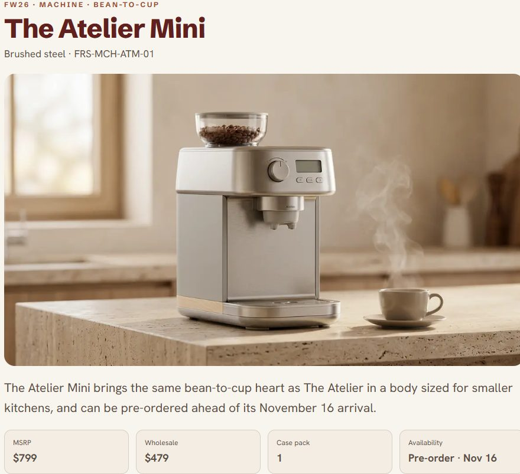
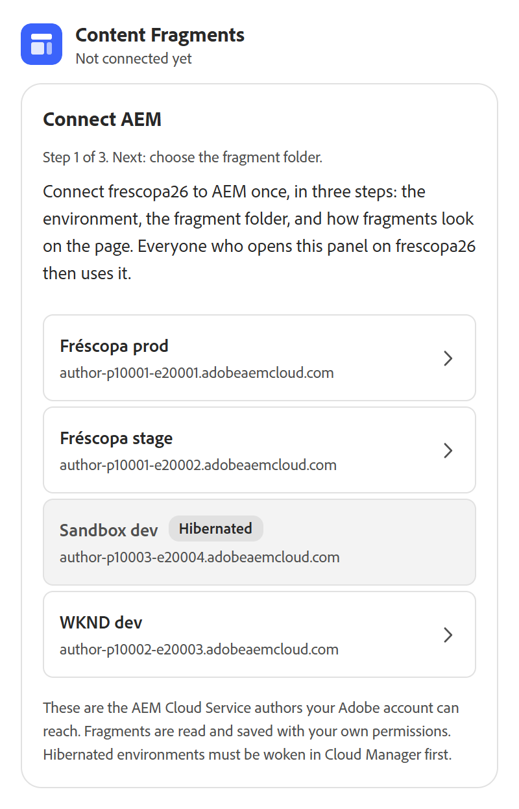
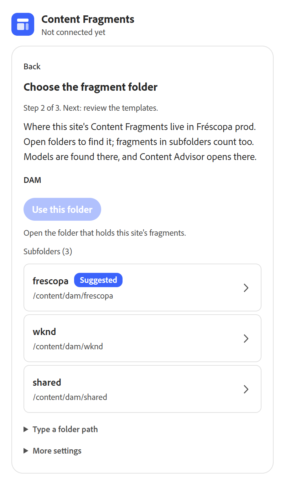
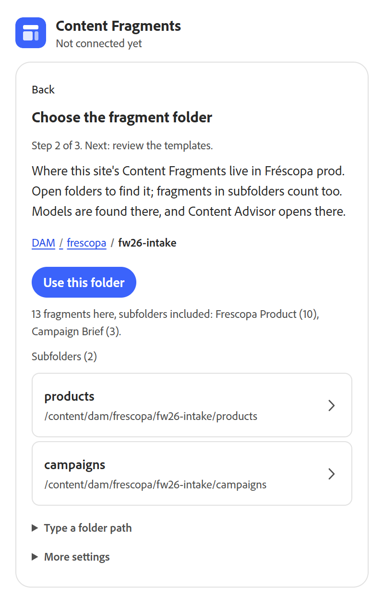
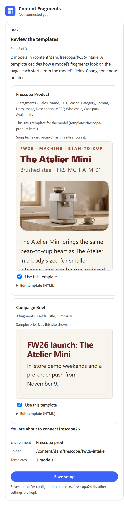
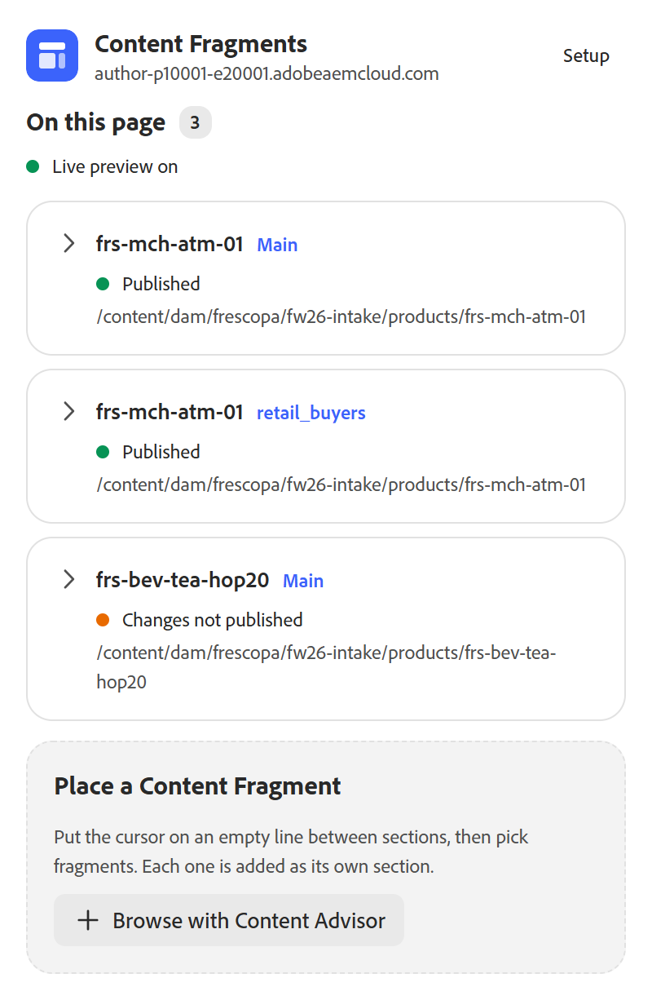
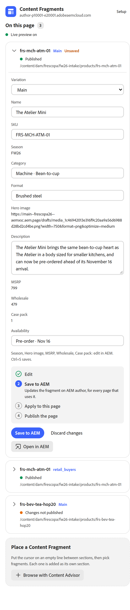
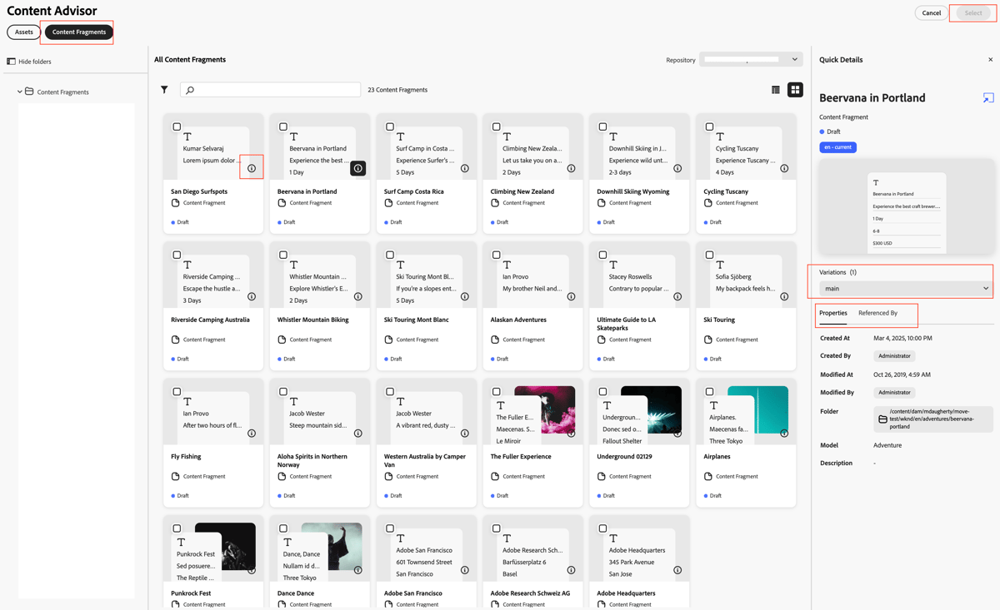

# Getting started

Use AEM Content Fragments on an Edge Delivery Services page, authored in DA and Experience
Workspace. Authors edit a fragment's fields beside the page and see the page change as they type.
They can also place new fragments with Adobe Content Advisor. Each fragment is drawn with its
model's template, in the site's own design.



*A Frescopa Product fragment on a page, drawn with the site's `cf-product` block. Screenshots in
this guide use Fréscopa demo content; environment names and IDs are made up.*

This guide has three parts:

1. [Add the extension to a site](#1-add-the-extension-to-a-site): a developer, once per site.
2. [Connect the site to AEM](#2-connect-the-site-to-aem): someone who can edit the site's DA
   configuration, once per site.
3. [Work with fragments on a page](#3-work-with-fragments-on-a-page): authors, every day.

How it works inside is in [architecture.md](architecture.md).

## Before you start

| You need | Why |
|---|---|
| An Edge Delivery Services site authored in DA (`da.live`) | The panel runs in DA's library and in Experience Workspace |
| An AEM as a Cloud Service author with Content Fragments | The fragments, their models and variations live there |
| An Adobe account that can open that author | The panel reads and saves fragments with your own permissions |
| Edit access to the site's DA configuration (setup only) | Setup saves its settings there |
| The fragments' images published in AEM | The page loads images from AEM publish; an unpublished image shows as broken |

Nothing is deployed on the AEM side. AEM author does not accept calls from `da.live` pages, so
the panel goes through a small broker service, and the broker calls AEM for you. By default it
uses the shared AEM XSC broker (see [architecture.md](architecture.md#the-broker)).

## 1. Add the extension to a site

In the site's GitHub repository:

1. Copy these folders and files from this repository's `site/` folder into the site repository,
   at the same paths:
   - `tools/content-fragments/`: the panel;
   - `scripts/cf-render.js` and `scripts/cf-bridge.js`;
   - `blocks/cf-card/`: the default look for models that have no template.
2. In `scripts/scripts.js`, load the bridge in `loadDelayed()`. It only runs when the page is
   shown inside the editor's preview:

   ```js
   import {
     decorateButtons, decorateIcons, decorateBlock, loadBlock, /* ...what is already imported */
   } from './aem.js';

   function loadDelayed() {
     // ...existing code
     const inPreview = window.self !== window.top
       && /\.aem\.page$|\.preview\.da\.live$/.test(window.location.hostname);
     if (inPreview) {
       import('./cf-bridge.js').then((m) => m.default({
         decorateButtons, decorateIcons, decorateBlock, loadBlock,
       }));
     }
   }
   ```

3. If the site lints its code, exclude the copied panel (add `tools/content-fragments/` to
   `.eslintignore` and `.stylelintignore`).
4. Optional, and worth it: give each fragment model its own look. Add a block for it (say
   `blocks/cf-product/`) and a template `tools/content-fragments/templates/<model name>.html`.
   Setup offers that template automatically. See
   [Writing templates](../README.md#writing-templates).
5. In DA, open the site's configuration (`https://da.live/config#/<org>/<site>`). In the
   `library` sheet, add a row with title `Content Fragments` and path
   `/tools/content-fragments/index.html`. Push the code, then go on to part 2.

## 2. Connect the site to AEM

Open any page of the site in Experience Workspace and open **Content Fragments** from the
library. The first time, the panel runs Setup: three steps, a few minutes, once per site.

### Step 1: pick the AEM environment

The list shows every AEM as a Cloud Service author your Adobe account can reach. Pick the one
that holds the site's fragments. Environments shown as **Hibernated** must be woken in Cloud
Manager first.



### Step 2: choose the fragment folder

Open folders until you reach the one that holds this site's fragments, then choose **Use this
folder**.
- **Suggested** marks a folder whose name matches the site.
- Each folder says how many fragments it holds and of which models, counting subfolders, so you
  can stop at the level that holds everything the site needs.
- A long list of folders gets a filter box. You can also type a path under **Type a folder
  path**.

<p>


</p>

**More settings** holds two options you rarely need: the link base (the origin for fragment
links that start with `/`) and the broker URL.

### Step 3: review the templates

Setup reads every fragment in the folder and lists the models it found. For each model, it shows
a real fragment drawn the way the site will show it:
- **This site's template** means the site ships a template for the model (part 1, item 4).
- Otherwise the model gets a starter template built from its fields, drawn with the generic
  `cf-card` block.

Clear **Use this template** to leave a model out. **Edit template (HTML)** changes a template
now; you can also change it later by opening Setup again.

The summary at the end says what will be saved. Choose **Save setup**.



Setup writes its settings to the site's DA configuration and keeps everything else there. The
first time, it also adds a **Content Advisor** entry to the library. Experience Workspace only
reads the library when it loads, so Setup reloads Workspace once by itself; you land back on
the same page. (In the classic DA editor, reload the page yourself.)

The panel now shows **Setup** at the top right. Use it to change the environment, folder or
templates later.

## 3. Work with fragments on a page

### See the fragments on the page

**On this page** lists each fragment the page uses, with its variation and its state in AEM:

| Label | Meaning |
|---|---|
| **Published** | The fragment on AEM publish matches author |
| **Changes not published** | Someone changed it on author since it was last published |
| **Not published** | It has never been published |

**Live preview on** means the panel is connected to the page preview beside it. Selecting a
row highlights that fragment's section in the preview.



### Edit a fragment

Open a row. The fields come from the fragment's model:
- Text fields can be edited here.
- Images, numbers, lists and other fields are shown read-only, with a note to edit them in AEM;
  **Open in AEM** opens the fragment in AEM's own editor.
- **Variation** switches between the main content and the fragment's variations.

The four steps under the fields show where you are:

1. **Edit.** The page preview follows as you type. Nothing is saved yet, and the row shows
   **Unsaved**.
2. **Save to AEM** (or Ctrl+S). Saves the fragment on AEM author, for every page and channel
   that uses it. If someone else changed it in the meantime, the save stops and asks you to
   reload rather than overwrite their work.
3. **Apply to this page.** Click inside the fragment's block in the editor, then Apply. This
   writes the new text into this page, and the page preview updates.
4. **Publish the page** from the editor when you are ready.



### Place new fragments with Content Advisor

1. In the editor, put the cursor on an empty line between two sections.
2. Choose **Browse with Content Advisor**. Adobe's Content Advisor opens on the folder chosen in
   Setup.
3. Pick one or more fragments, and variations if you want them, then choose **Insert**.



*Content Advisor's Content Fragments tab. Image from Adobe Experience League,
[Use Content Advisor](https://experienceleague.adobe.com/en/docs/experience-manager-cloud-service/content/assets/content-advisor/integrate-adobe-non-adobe-applications).*

Each fragment becomes its own section, drawn with its model's template, with the section
metadata (`Fragment`, `Variation`) the panel uses to find it again.

### When does a change go live?

The page holds its own copy of each fragment's content, so visitors and search engines see it
without waiting for AEM.
- **Save to AEM** changes the fragment on author, nowhere else.
- **Apply to this page** and then **Publish the page** put the change on the live site.
- **Publishing the fragment in AEM** is not needed for this page. Do it when other channels
  read the fragment from AEM publish, and always for its images.
- **Changes made in AEM's own editor** reach the page the next time someone opens the fragment
  in the panel and applies it. Re-rendering pages automatically when a fragment is published is
  on the [roadmap](../README.md#roadmap).

## Troubleshooting

| You see | What to do |
|---|---|
| **Live preview off** | Reload the page preview. If it stays off, check that `scripts.js` loads `cf-bridge.js` (part 1, step 2) and that the code is pushed |
| An environment you expect is missing in Setup | Your Adobe account has no access to it. Ask an AEM administrator for access, then open Setup again |
| **Hibernated** environment | Wake it in Cloud Manager, then open Setup again |
| **Browse with Content Advisor** does nothing | The library has no Content Advisor entry yet. Open Setup and save, or reload Experience Workspace once |
| **Apply to this page** is unavailable | Click inside the fragment's block in the editor first |
| "The fragment changed in AEM since it was loaded" | Someone saved it after you opened it. Reload the fragment and make your change again |
| A broken image on the page | Publish the image in AEM |
| A block looks wrong after an insert | The site's block may read rows by their number of cells. See [Writing templates](../README.md#writing-templates) |
| "Could not reach AEM through the broker" | Try again in a moment. If it continues, the broker may be down; see [architecture.md](architecture.md#the-broker) |
